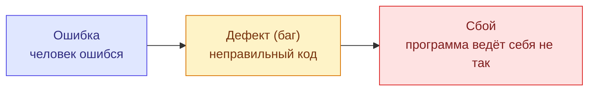

# Кто такой тестировщик

<LessonTabs>
<template #theory>

## Простыми словами

Тестировщик проверяет, что программа делает то, что от неё ждут. И находит места, где это не так, — раньше, чем на них наткнётся пользователь.

Это не «придираться ко всему подряд», а понятная работа: сравнивать, как должно быть и как есть на самом деле, и внятно рассказывать команде о расхождениях.

## Роль тестировщика в команде

У работы тестировщика несколько сторон.

**Проверять ожидаемое поведение.** В требованиях или в задаче написано, что должно происходить. Тестировщик проверяет, что происходит на самом деле. Причём не только в очевидном сценарии, но и в редких и ошибочных: пустое поле, слишком длинное значение, неправильный пароль.

**Искать то, что не описано.** Требования почти никогда не покрывают всех случаев. Что будет, если отправить один и тот же запрос дважды? Если два человека одновременно поменяют одну задачу? Часть работы — додумать такие сценарии самому.

**Рассказывать о находках.** Найти проблему — только половина дела. Вторая половина — описать её так, чтобы разработчик смог её повторить и исправить, а не переспрашивал. Этому посвящён отдельный урок про баг-репорты.

**Смотреть и глазами пользователя, и «под капот».** Тестировщик не только нажимает кнопки и смотрит на экран. Он может посмотреть, что пришло в ответе сервера и что записалось в базу данных, и сравнить это с ожиданием.

### Зачем тестировщик, если разработчик сам проверяет код

Дело не в том, что разработчики «плохо пишут код». У автора и у проверяющего разный взгляд. Автор видит, как он задумал и написал программу. Тестировщик видит, как она ведёт себя на самом деле. Нужны оба взгляда.

::: tip Тестировщик или QA-инженер?
В этом курсе это синонимы. В вакансиях встречаются оба названия, и чаще всего они означают одну и ту же работу. В некоторых компаниях «QA-инженером» называют роль пошире — с участием в процессах команды, а не только в проверках. Почему так получается, станет понятно из следующего раздела.
:::

## QA, QC и тестирование

Эти три слова часто путают. Они связаны, но означают разное. Удобно представить их как вложенные круги: самый большой — QA, внутри него QC, а внутри QC — тестирование.

<figure class="nested-circles">
<svg viewBox="0 0 360 360" role="img" aria-label="Вложенные круги: QA содержит QC, QC содержит тестирование">
  <circle cx="180" cy="180" r="172" fill="#dbeafe" stroke="#2563eb" stroke-width="3"/>
  <circle cx="180" cy="208" r="122" fill="#dcfce7" stroke="#16a34a" stroke-width="3"/>
  <circle cx="180" cy="236" r="72" fill="#fef3c7" stroke="#d97706" stroke-width="3"/>
  <text x="180" y="40" text-anchor="middle" font-size="20" font-weight="700" fill="#1e3a8a">QA</text>
  <text x="180" y="62" text-anchor="middle" font-size="13" fill="#1e3a8a">обеспечение качества</text>
  <text x="180" y="122" text-anchor="middle" font-size="20" font-weight="700" fill="#14532d">QC</text>
  <text x="180" y="144" text-anchor="middle" font-size="13" fill="#14532d">контроль качества</text>
  <text x="180" y="232" text-anchor="middle" font-size="17" font-weight="700" fill="#78350f">Тестирование</text>
  <text x="180" y="254" text-anchor="middle" font-size="13" fill="#78350f">конкретные проверки</text>
</svg>
</figure>

**QA (Quality Assurance, обеспечение качества)** — всё, что команда делает, чтобы ошибок было меньше с самого начала. Это про процесс: как пишутся требования, как команда договаривается, когда и что проверять.

> **Пример в TaskFlow.** Команда договорилась: для каждого поля в описании API (файл `docs/API_SPEC.md`) записывать ограничения. Например, что пароль — от 8 до 64 символов. Теперь разработчику и тестировщику не нужно гадать. Это QA: ошибку предупредили ещё до того, как написали код.

**QC (Quality Control, контроль качества)** — проверка уже готового продукта: соответствует ли он требованиям. Это про результат.

> **Пример в TaskFlow.** Вышла новая сборка. Перед тем как отдать её пользователям, её проверяют: работают ли регистрация, создание задач, комментарии. Решают, готова ли сборка. Это QC.

**Тестирование** — конкретные проверки внутри QC: запустить программу, выполнить действия и сравнить результат с ожидаемым.

> **Пример в TaskFlow.** Отправить запрос на регистрацию с паролем из 7 символов и посмотреть, отклонит ли его система. Это тестирование.

Коротко: QA — как сделать, чтобы ошибок было меньше; QC — есть ли ошибки в готовом продукте; тестирование — конкретная проверка.

## Ошибка, дефект, сбой

В разговоре всё это называют одним словом «баг». Но у этих слов есть точный смысл, и на собеседовании его спрашивают.

- **Ошибка** (error) — промах человека. Разработчик что-то не так понял или опечатался.
- **Дефект** (defect, он же **баг**) — след этого промаха в продукте: неправильная строчка кода, неверное требование.
- **Сбой** (failure) — то, что видно снаружи: программа ведёт себя не так, как должна.



**Придуманный пример.** Это не настоящий баг TaskFlow, а иллюстрация. По спецификации имя (`firstName`) — от 1 до 50 символов.

1. **Ошибка:** разработчик торопился и в проверке длины имени написал `5` вместо `50`.
2. **Дефект:** в коде теперь лежит неправильное число.
3. **Сбой:** человек с именем «Николай» (7 букв) не может зарегистрироваться — система отвечает, что имя слишком длинное.

Важно: дефект может долго «спать» и не вызывать сбоя. Пока все пользователи регистрируются с короткими именами, никто ничего не заметит. Тестировщик ищет как раз такие места.

## Верификация и валидация

Ещё одна пара слов, которую любят спрашивать.

**Верификация** отвечает на вопрос: «Мы сделали продукт правильно?» То есть так, как написано в требованиях.

**Валидация** отвечает на вопрос: «Мы сделали правильный продукт?» То есть то, что действительно нужно пользователю.

| | Верификация | Валидация |
|---|---|---|
| Вопрос | Сделали по требованиям? | Это решает задачу пользователя? |
| С чем сравниваем | Со спецификацией, ТЗ | С реальными потребностями людей |
| Пример в TaskFlow | Пароль из 7 символов отклоняется, как написано в спецификации | Пользователям удобно вести задачи — им не нужно искать обходные пути |

Продукт может пройти верификацию, но не пройти валидацию. Всё сделано строго по требованиям, а пользоваться неудобно. Значит, ошиблись в самих требованиях.

## 7 принципов тестирования

ISTQB — международная организация, которая описывает стандарты тестирования. Она сформулировала семь принципов. Это не правила «как делать», а наблюдения, которые подтвердились на практике.

| # | Принцип | Простыми словами | Пример в TaskFlow |
|---|---|---|---|
| 1 | Тестирование показывает наличие дефектов, а не их отсутствие | Тесты могут найти баг, но не могут доказать, что багов нет | Все проверки регистрации прошли — это не значит, что в регистрации нет ни одного бага |
| 2 | Исчерпывающее тестирование невозможно | Проверить все варианты нельзя, поэтому выбираем самые важные | В поле «Название задачи» можно ввести бесконечно много разных строк |
| 3 | Раннее тестирование экономит время и деньги | Чем раньше нашли проблему, тем дешевле её исправить | Противоречие в спецификации дешевле поправить до того, как по ней написали код |
| 4 | Дефекты скапливаются вместе | Большая часть багов обычно живёт в небольшой части программы | Нашёл несколько багов в правах доступа — там стоит покопать ещё |
| 5 | Тесты «изнашиваются» | Одни и те же проверки со временем перестают находить новое | Если всегда проверять только создание задачи, баги в комментариях не найдёшь |
| 6 | Тестирование зависит от контекста | Что и как проверять, зависит от продукта | Трекер задач проверяют иначе, чем банковское приложение |
| 7 | Отсутствие багов — не гарантия успеха | Продукт без багов может быть никому не нужен | TaskFlow может работать идеально, но если в нём неудобно вести задачи, им не будут пользоваться |

Принцип 5 ещё называют **парадоксом пестицида**: как насекомые привыкают к одному яду, так программа «привыкает» к одним и тем же тестам. Проверки нужно время от времени обновлять.

Принцип 7 — это та самая валидация из предыдущего раздела.

## Инструмент: Swagger

В практике этого урока ты будешь отправлять запросы к TaskFlow. Для этого есть **Swagger** — страница в браузере, на которой описаны все запросы API. Прямо оттуда их можно отправить и посмотреть ответ. Ничего устанавливать не нужно.

Когда TaskFlow запущен у тебя на компьютере, Swagger открывается по адресу:

```text
http://localhost:8000/docs
```

Как с ним работать:

1. Запросы сгруппированы по темам. Например, всё про вход и регистрацию — в группе **Auth**.
2. Нажми на запрос, чтобы раскрыть его описание.
3. Нажми **Try it out** — появится поле, где можно отредактировать тело запроса.
4. Нажми **Execute** — запрос уйдёт на сервер.
5. Ниже, в блоке **Responses**, появится ответ: код (например, `201` или `422`) и текст ответа.

Что такое API, запросы и коды ответов, подробно разберём в блоке «Клиент-сервер и API». Сейчас достаточно знать: `2xx` — успех, `4xx` — запрос отклонён, в тексте ответа обычно написано почему.

## На открытом проекте

Взгляд тестировщика можно потренировать без TaskFlow. Открой учебную страницу входа [the-internet.herokuapp.com/login](https://the-internet.herokuapp.com/login). Это открытый сайт для тренировки тестировщиков.

На странице написано, какие логин и пароль правильные. Это наше «требование». Посмотри на форму как тестировщик и задай себе вопросы:

- Что будет, если оставить логин пустым? А пароль?
- Что будет, если ввести правильный логин и неправильный пароль?
- Понятно ли из сообщения об ошибке, что именно не так?
- Что будет после входа, если нажать кнопку «Назад» в браузере?

Ответов «правильно» или «неправильно» здесь нет. Цель — заметить, сколько вопросов можно задать даже маленькой форме из двух полей.

## Частые ошибки новичков

- **Думать, что за качество отвечает только тестировщик.** Качество — общая задача команды. Тестировщик помогает его увидеть и улучшить, но не может «добавить» его в одиночку.
- **Считать, что цель — найти как можно больше багов.** Цель — дать команде точную картину: что работает, что нет и насколько это важно. Один найденный серьёзный баг ценнее двадцати опечаток.
- **Думать, что если багов не нашли, то их нет.** Это первый принцип тестирования: тесты показывают наличие дефектов, а не их отсутствие. Честная формулировка: «в проверенных сценариях багов не найдено».
- **Считать баг своим мнением.** «Мне кажется, так неправильно» — ещё не баг. Сначала найди, как должно быть: в требованиях, спецификации или у того, кто ставил задачу.
- **Путать QA и тестирование.** Тестирование — только часть работы над качеством, а не всё обеспечение качества.

</template>
<template #task>

## Что нужно сделать

Первое практическое задание совсем небольшое. Цель — не проверить всё API, а один раз пройти настоящий цикл: **понаблюдать → записать → сдать**.

Ты проверишь запрос регистрации TaskFlow и выяснишь, какие поля в нём на самом деле обязательны — по ответам системы.

**Ветка TaskFlow:** `training-public`. Перед началом запусти TaskFlow у себя на компьютере. Пошаговая инструкция — в файле `README.md` репозитория TaskFlow (ветка `training-public`).

## Шаг 1. Открой Swagger и найди регистрацию

1. Открой в браузере `http://localhost:8000/docs`. Если страница не открывается, проверь, что TaskFlow запущен.
2. Найди группу **Auth**.
3. Раскрой в ней запрос `POST /api/v1/auth/register`.
4. Нажми **Try it out**.

## Шаг 2. Отправь запрос со всеми полями

Тело запроса регистрации состоит из четырёх полей: `email`, `password`, `firstName`, `lastName`. Замени содержимое поля **Request body** на такое:

```json
{
  "email": "student1@example.com",
  "password": "Qwerty123",
  "firstName": "Иван",
  "lastName": "Петров"
}
```

Нажми **Execute** и посмотри на код ответа. Если регистрация прошла, это будет `201`.

Если пришёл `409` — такой email уже занят. Поменяй цифру в email и отправь ещё раз.

## Шаг 3. Убирай по одному полю

Теперь отправь четыре запроса. В каждом убери **ровно одно** поле, остальные оставь заполненными правильно:

1. без `email`;
2. без `password`;
3. без `firstName`;
4. без `lastName`.

Каждый раз бери **новый email**: `student2@example.com`, `student3@example.com` и так далее. Так ответ будет точно про убранное поле, а не про занятый email.

Для каждого запроса запиши:

- какое поле убрал;
- какой код ответа пришёл (`201`, `422` или другой);
- что написано в ответе, если пришла ошибка.

Удобно вести записи в таблице:

| Убрал поле | Код ответа | Текст ошибки | Обязательно по факту? |
|---|---|---|---|
| `email` | | | |
| `password` | | | |
| `firstName` | | | |
| `lastName` | | | |

::: tip Две ловушки
**Запятая.** Когда удаляешь из JSON последнее поле, убери и запятую в конце предыдущей строки. Иначе сервер ответит ошибкой из-за неправильного JSON, а не из-за пропущенного поля.

**Код 429.** Регистрация ограничена: не больше 10 запросов в минуту. Если пришёл `429`, это ничего не говорит о поле. Подожди минуту и отправь тот же запрос ещё раз.
:::

Здесь ты только записываешь, что увидел. Сравнивать наблюдения с документацией и решать, баг это или нет, ты научишься в уроке про баг-репорты.

## Разминка на открытом проекте

TaskFlow пока не запускается? Потренируйся на форме входа [the-internet.herokuapp.com/login](https://the-internet.herokuapp.com/login).

1. Попробуй войти: с пустым логином, с пустым паролем, с обоими пустыми полями, с правильными данными.
2. Для каждой попытки запиши, что ввёл и какое сообщение увидел.

Когда TaskFlow заработает, вернись к шагам 1–3: основное задание — по TaskFlow.

## Как сдавать

Отправь записи куратору лично — в чат или на созвоне.

Что должно быть в результате:

- таблица из шага 3: поле → код ответа → текст ошибки → обязательно ли поле по факту;
- код ответа на запрос со всеми полями из шага 2.

</template>
<template #questions>

## Ситуационные кейсы

Это рабочие ситуации, о которых могут спросить и на собеседовании. Готового ответа, который нужно угадать, здесь нет. Сначала подумай сам, потом открывай разбор.

::: details Кейс 1. «Это не баг, это фича»
**Ситуация.** Ты завёл баг: система ведёт себя не так, как ты ожидал. Разработчик отвечает: «Это не баг, это фича» — так сделано специально. Что ты делаешь дальше?

**Как рассуждать.** «Баг это или нет» — вопрос не мнения, а источника: описания задачи, спецификации, прошлого решения по похожему вопросу. Либо такой источник есть, либо нет. Подумай, чем отличаются позиции «я всё равно уверен, что это баг» и «давай уточним, как задумано».

**Пример ответа.** Я не буду спорить напрямую. Сначала проверю, где записано, как должно быть.

Если источник есть и разработчик прав — спор закрыт. Моё ожидание было неверным, и это нормально. Если источник на моей стороне — я покажу именно его, а не свою уверенность. Документ снимает спор, а мнение — нет.

Если источника нет, ни я, ни разработчик не можем решить это между собой. Мы не определяем требования. Я задам вопрос тому, кто за них отвечает, — владельцу продукта или аналитику. А решение попрошу записать, чтобы следующему человеку не пришлось поднимать тот же спор.

Позиция «я уверен, что это баг» ищет, кто прав. Позиция «давай уточним» ищет ответ, который закроет вопрос для всех.
:::

::: details Кейс 2. «Давай зарелизим без тестирования, доделаем потом»
**Ситуация.** Скоро дедлайн, тестирование фичи не закончено. Менеджер предлагает: «Времени нет, выпустим как есть, баги поправим потом». Ты не уверен, что это хорошая идея. Как ты поведёшь этот разговор?

**Как рассуждать.** Тут два плохих варианта: молча согласиться или в одиночку заблокировать релиз. Ни один не помогает менеджеру принять решение. Подумай, чем фраза «я не успел протестировать» отличается от конкретного списка: что проверено, что нет и чем это грозит.

**Пример ответа.** Я превращу «не успел» в конкретный список:

- что уже проверено и работает;
- что осталось непроверенным;
- какие риски скрываются в непроверенной части.

Риски бывают разной цены. Не проверена редкая мелочь в оформлении — одно дело. Не проверены права доступа между ролями — совсем другое.

Решение о релизе обычно принимает не тестировщик, а тот, кто отвечает за продукт. Моя задача — чтобы решение принималось осознанно. Если после релиза всплывёт баг, «мы знали и сознательно рискнули» — это нормальная работа. А «никто не предупредил» — провал, которого тестировщик допускать не должен.
:::

::: details Кейс 3. «У меня не воспроизводится»
**Ситуация.** Ты сообщил о баге. Разработчик отвечает: «У меня всё работает, не воспроизводится». Что ты делаешь?

**Как рассуждать.** «У меня баг, а у него нет» почти всегда значит, что отличается какое-то условие, а не что кто-то ошибся. Разное окружение, разные данные, разные шаги — даже незаметная разница вроде роли пользователя или порядка действий.

**Пример ответа.** Я не буду думать «он плохо проверил» или «я что-то напутал». Вместо спора сверю по пунктам всё, из чего состоит воспроизведение:

- окружение: та же ли версия программы, тот же ли стенд и база;
- данные: тот же ли проект и задача, а не «похожие»;
- роль: под каким пользователем и с какими правами выполнялось действие;
- шаги: в каком порядке, что было создано или изменено до проверки.

Часто разница прячется в детали, которую я не счёл важной и не упомянул. Поэтому шаги стоит записывать максимально подробно, а не по памяти.

Если всё совпадает, а баг у разработчика всё равно не повторяется, — это уже более редкий случай: дело в окружении или во времени выполнения. Подробные шаги — единственный способ отличить «разные условия» от по-настоящему нестабильного поведения. Как их писать, разберём в уроке про баг-репорты.
:::

## Вопросы для собеседования

<InterviewTrainer topic="osnovy/kto-takoy-testirovschik" />

</template>
</LessonTabs>
