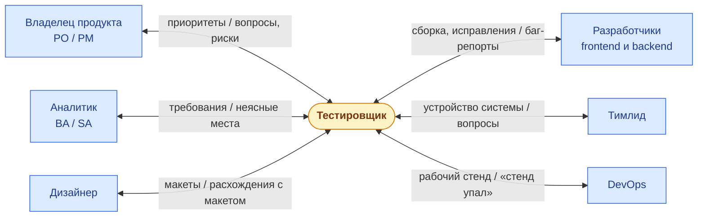

# Команда и роли

<LessonTabs>
<template #theory>

## Простыми словами

Тестировщик почти никогда не работает один. Рядом с ним люди, которые придумывают продукт, рисуют его, пишут код и следят за серверами.

От них тестировщик получает то, без чего не начать проверку: требования, макеты, готовую сборку. А им отдаёт результат своей работы: найденные баги, вопросы, оценку рисков.

В этом уроке разберёмся, кто есть кто в команде и к кому с каким вопросом идти. Это пригодится в следующих уроках: баг-репорт для разработчика и вопрос для владельца продукта пишутся по-разному, даже если речь об одной и той же находке.

## Кто есть кто в команде

Состав команды отличается от компании к компании. Ниже — роли, которые тестировщик встречает чаще всего.

**Владелец продукта** (Product Owner, PO) или **менеджер продукта** (Product Manager, PM) решает, что и зачем делает команда. Если нигде не написано, как должно быть, последнее слово за ним.

**Аналитик** превращает идею в подробные требования. Бизнес-аналитик (BA) больше думает о задачах пользователей, системный аналитик (SA) — о том, как это устроено технически. Аналитик есть не в каждой команде: в маленьких его работу часто делает сам PO.

**Дизайнер** рисует **макеты** — картинки того, как должны выглядеть экраны, кнопки, сообщения об ошибках. Для тестировщика макет — источник ожидаемого вида интерфейса.

**Разработчики** пишут код. **Frontend-разработчик** делает то, что пользователь видит в браузере или в приложении. **Backend-разработчик** — серверную часть: хранение данных, проверки, права доступа.

**Тимлид** (руководитель команды разработки) отвечает за технические решения: как всё устроено внутри.

**DevOps-инженер** отвечает за серверы и **стенды** — копии продукта, на которых команда проверяет новые версии. Он же выкатывает на стенд новую **сборку** — готовую к проверке версию продукта.

| Роль | Что делает | Что тестировщик от него получает | Что тестировщик ему отдаёт |
|---|---|---|---|
| PO / PM | Решает, что и зачем делать | Приоритеты, ответы «как должно быть» | Вопросы по требованиям, оценку рисков перед релизом |
| Аналитик (BA / SA) | Пишет подробные требования | Требования, спецификации | Неясные места и противоречия в требованиях |
| Дизайнер | Рисует макеты | Макеты | Расхождения между макетом и реализацией |
| Frontend-разработчик | Делает видимую часть | Новые экраны и исправления | Баг-репорты по интерфейсу |
| Backend-разработчик | Делает серверную часть | Новые запросы API и исправления | Баг-репорты по API и данным |
| Тимлид | Отвечает за техническое устройство | Объяснения, как работает система внутри | Вопросы об устройстве системы, сигналы о повторяющихся проблемах |
| DevOps | Следит за стендами и выкатывает сборки | Рабочий стенд, новую сборку | Сообщения «стенд не работает» |

Чаще всего тестировщик общается с разработчиками: им адресован почти каждый найденный баг. На втором месте — владелец продукта: к нему идут, когда непонятно, как должно быть.

## Тестировщик в центре

Тестировщик связан почти со всеми в команде. На схеме у каждой стрелки подпись: **слева от косой черты — что тестировщик получает, справа — что отдаёт**.

Обрати внимание: тестировщик не только «принимает» работу у разработчиков. Он участвует с самого начала — задаёт вопросы по требованиям ещё до того, как написан код. Такой вопрос стоит дешевле, чем баг, найденный потом.

## Продуктовая команда и аутсорс

Есть два частых способа устроить работу тестировщика. Разница не в том, какой лучше, а в условиях.

**Продуктовая команда** работает над своим продуктом — долго, часто годами. Ты видишь, к чему приводят твои находки: пропущенный сегодня баг может всплыть у тех же пользователей через полгода.

**Аутсорс** (или агентство) — компания делает продукт для клиента по договору. Клиент — заказчик, ты — исполнитель. Между вами часто стоит менеджер, а вопросы идут через определённый канал.

| | Продуктовая команда | Аутсорс |
|---|---|---|
| На кого работаешь | На свою компанию и её продукт | На клиента по договору |
| Сколько длится работа | Долго, часто годами | Пока идёт контракт |
| Знаешь ли, зачем нужна фича | Обычно да: контекст под рукой | Часто нет: требование приходит готовым, без «почему» |
| Как задать вопрос | Подойти к автору требования напрямую | Через менеджера или согласованный канал, ответ может идти днями |
| Сколько проектов | Обычно один продукт | Бывает несколько проектов для разных клиентов |
| Видишь ли последствия | Да, через месяцы и годы | Часто нет: проект сдан — и ты уже на другом |

### Что это меняет для тестировщика

Главное — две вещи: **сколько у тебя информации** о том, зачем всё это нужно, и **к кому идти**, когда ответа нет.

- В продуктовой команде можно быстро уточнить у автора требования. Зато легко привыкнуть к продукту и перестать замечать его странности.
- На аутсорсе вопросы дороже: каждый уходит через посредника и ждёт ответа. Поэтому их лучше собирать, задавать письменно и сохранять ответы. Устная договорённость через менеджера легко искажается.

Ты можешь встретить оба формата за карьеру. В обоих можно быть хорошим тестировщиком, если понимаешь, как в твоём проекте устроен доступ к информации.

## Средний состав команды

Точной формулы нет. Но типичная продуктовая команда выглядит примерно так:

- владелец продукта — один;
- аналитик — один, или его нет, и требования пишет PO;
- дизайнер — один, часто сразу на несколько команд;
- разработчики — обычно от трёх до восьми, frontend и backend;
- тестировщики — один-два;
- тимлид — один, иногда это один из разработчиков;
- DevOps — часто общий на несколько команд.

Сколько тестировщиков на разработчиков — зависит от продукта и компании. Часто встречается примерно **один тестировщик на три–пять разработчиков**. Но бывает и один на десять, и почти один к одному — например, там, где ошибка стоит очень дорого, как в банках и медицине.

На собеседовании полезно спросить, сколько в команде разработчиков и тестировщиков. Так ты поймёшь, какой будет нагрузка.

## Важно: роли в команде и роли в системе — не одно и то же

Это частая путаница у новичков, поэтому разберём отдельно.

**Роль в команде** — это должность человека: разработчик, дизайнер, тестировщик. Она про то, чем человек занимается на работе.

**Роль в системе** — это права пользователя внутри программы: что ему можно делать, а что нельзя. Она про доступ, а не про профессию.

В TaskFlow роли в системе такие (их описание — в файле `docs/API_SPEC.md`, раздел «Ролевая модель»):

| Роль в TaskFlow | Что может пользователь |
|---|---|
| `USER` | Обычный пользователь. Эту роль получает каждый после регистрации |
| `ADMIN` | Администратор всей системы: управляет пользователями и метками, видит все проекты |
| `VIEWER` | В конкретном проекте: смотреть проект, задачи, участников и оставлять комментарии |
| `MANAGER` | Всё, что `VIEWER`, плюс создавать, менять и удалять задачи, привязывать метки |
| `OWNER` | Всё, что `MANAGER`, плюс удалять проект и управлять его участниками |

`USER` и `ADMIN` — роли на всю систему. `VIEWER`, `MANAGER` и `OWNER` — роли в конкретном проекте. Один и тот же человек может быть `OWNER` в своём проекте и `VIEWER` в чужом.

Ни одна из этих ролей не говорит, кем человек работает. `OWNER` — не обязательно начальник, `VIEWER` — не обязательно тестировщик. Это пользователи TaskFlow — те, кто ведёт в нём свои задачи.

> **Пример.** Когда ты проверяешь права в TaskFlow, ты сам создаёшь пользователей с разными ролями: один `OWNER`, другой `VIEWER`. При этом ты остаёшься тестировщиком. Роль в системе — это костюм, который ты надеваешь для проверки, а не твоя должность.

В практике этого урока ты будешь сопоставлять роли TaskFlow с ролями в команде. Это мысленный эксперимент: «Если бы команда вела свою работу в TaskFlow, какую роль в системе выдали бы каждому?» Он помогает понять, зачем вообще нужны разные права.

## Частые ошибки новичков

- **Писать разработчику в личные сообщения вместо трекера.** Сообщение в личке теряется, его не видят другие, по нему нельзя отследить, исправлен ли баг. Баг — в **трекер задач** (систему, где команда ведёт задачи и баги, например Jira), а в личку можно написать «завёл баг, посмотри, когда будет время».
- **Считать разработчика противником.** Тестировщик и разработчик делают одно дело — хороший продукт. Баг-репорт — это не обвинение, а помощь. Описывай факты, а не «кто виноват».
- **Молчать о непонятных требованиях.** Если что-то неясно, спроси сразу. Тестировать по своей догадке «наверное, так и задумано» — значит потом спорить, баг это или нет.
- **Идти с вопросом не к тому человеку.** «Как должно быть?» — к владельцу продукта или аналитику. «Почему стенд не открывается?» — к DevOps. Разработчик не решает, каким должен быть продукт, а дизайнер не может сам поправить код.
- **Путать роли в системе с ролями в команде.** `OWNER`, `MANAGER`, `VIEWER` — права пользователей программы, а не должности людей в команде.

</template>
<template #task>

## Что нужно сделать

Это задание не про поиск багов. Цель — посмотреть на команду через ролевую модель TaskFlow и найти в ней место тестировщика.

Представь, что ваша команда ведёт свою работу в TaskFlow. Кому какую роль в системе ты бы выдал и почему?

**Ветка TaskFlow:** `training-public`. Запускать TaskFlow для этого задания не обязательно: всё нужное есть в документации. Если хочешь посмотреть роли в Swagger, запусти TaskFlow по инструкции из файла `README.md` репозитория TaskFlow (ветка `training-public`).

## Шаг 1. Выпиши роли TaskFlow

1. Открой файл `docs/API_SPEC.md` в репозитории TaskFlow, раздел «3. Ролевая модель».
2. Выпиши глобальные роли: `USER`, `ADMIN`.
3. Выпиши проектные роли: `VIEWER`, `MANAGER`, `OWNER`. Для каждой — коротко, что она разрешает.

В проектных ролях есть ещё `ADMIN`. Она информационная: выдаётся автоматически администратору системы и прав не меняет. В этом задании её можно пропустить.

## Шаг 2. Сопоставь роли TaskFlow с ролями в команде

Для каждой проектной роли (`VIEWER`, `MANAGER`, `OWNER`) напиши:

- кто в команде, скорее всего, получил бы эту роль;
- почему — опираясь на права роли.

Удобно оформить таблицей. Одна строка заполнена как образец формата, а не как готовый ответ — свои строки обоснуй своими словами:

| Роль в TaskFlow | Кто в команде | Почему |
|---|---|---|
| `OWNER` | Например, менеджер продукта или тимлид | Может удалить проект и управлять участниками — это ответственность за проект целиком |
| `MANAGER` | | |
| `VIEWER` | | |

Правильного ответа «один на всех» здесь нет. В разных командах роли раздают по-разному — важно обоснование.

## Шаг 3. Где в этой модели тестировщик

Отдельной роли «тестировщик» в TaskFlow нет. Ответь письменно на два вопроса.

1. Представь, что тестировщику дали роль `VIEWER`. Какого доступа ему не хватит в обычной работе? Подсказка: подумай про статус задачи. Сможет ли он, оставаясь `VIEWER`, перевести баг обратно в работу, если исправление не помогло?
2. Почему тестировщику обычно не дают `MANAGER` или `OWNER`, хотя это решило бы проблему с доступом?

На второй вопрос в этом уроке готового ответа нет. Права доступа и баланс между «доступа хватает для работы» и «лишний доступ — это риск» разберём в уроке про роли и права. Сейчас запиши свою первую догадку — потом к ней можно будет вернуться.

## Как сдавать

Покажи ответы куратору лично — в чат или на созвоне.

Что должно быть в результате:

- список ролей TaskFlow из шага 1;
- таблица из шага 2: роль TaskFlow → кто в команде → почему;
- ответы на оба вопроса из шага 3.

</template>
<template #questions>

## Ситуационные кейсы

Это рабочие ситуации, о которых могут спросить и на собеседовании. Готового ответа, который нужно угадать, здесь нет. Сначала подумай сам, потом открывай разбор.

::: details Кейс 1. Устное описание вместо требований
**Ситуация.** Ты на аутсорс-проекте. Менеджер клиента просит протестировать новую фичу. Письменных требований у тебя нет — только устный пересказ от клиента, переданный через менеджера. Что ты делаешь?

**Как рассуждать.** Проблема не в том, что без документа нельзя тестировать. Проблема в том, что пересказ через посредника легко искажается. И к нему нельзя вернуться, если потом возникнет спор. Подумай, что ты можешь сделать сам, не дожидаясь, пока кто-то напишет требования.

**Пример ответа.** Я не буду тестировать по памяти о том, что мне сказали. Сначала запишу, как я понял фичу, и отправлю тому, кто её описал: «Правильно ли я понимаю, что фича делает вот это, а в таком-то случае — вот это?»

Так устный пересказ превращается в текст, который подтвердил заказчик. К нему можно вернуться, если позже будет спор.

Отсутствие письменных требований на аутсорсе — обычное дело, и это не повод останавливать работу. Но в заметках и баг-репортах я отмечу, что ожидания взяты из устного описания. Если ожидание окажется неверным, разбираться нужно будет с описанием, а не с моей логикой.
:::

::: details Кейс 2. Кнопка не того цвета
**Ситуация.** На макете дизайнера кнопка одного цвета, а разработчик сделал её другого. Это баг, вопрос к дизайну или к разработке? И кому ты сообщаешь?

**Как рассуждать.** Расхождение с макетом — отклонение от записанного ожидания, то есть это дефект. Но «баг ли это» и «кто будет исправлять» — разные вопросы. Причин может быть несколько: ошибка при вёрстке, старая версия макета у разработчика или устаревший сам макет, который забыли обновить после изменения дизайна.

**Пример ответа.** Я заведу баг в трекере, чтобы его увидели и разработчик, и остальная команда. Писать только дизайнеру нет смысла: он не может сам поменять код, и находка потеряется.

Формулировка будет нейтральной: «Цвет кнопки отличается от макета», а не «разработчик перепутал цвет». Причина пока неизвестна, и обвинение уведёт разговор не туда.

Дальше всё решает сверка с актуальной версией макета. Если в макете один цвет, а в продукте другой — это ошибка реализации, исправляет разработчик. Если дизайн поменяли, а макет не обновили — проблема в макете, и дизайнеру нужно его поправить. Иначе тот же вопрос возникнет у следующего человека.

Я не решаю сам, кто прав. Я фиксирую факт расхождения и отдаю его тем, кто может внести изменение.
:::

::: details Кейс 3. Требования в два предложения
**Ситуация.** Ты в маленькой команде без аналитика. Требования пишет сам владелец продукта — пару предложений в задаче. Как это меняет твою работу по сравнению с командой, где есть подробная спецификация?

**Как рассуждать.** Тестов меньше не становится. Просто работу по уточнению деталей теперь не сделал никто заранее. Кому-то придётся додумать граничные случаи и исключения. Подумай: что будет с вопросами, которые у тебя возникнут, если держать их в голове?

**Пример ответа.** Без аналитика часть его работы ложится на меня. Мне придётся самому продумать то, что в коротком описании не упомянуто: пустые значения, повторные действия, границы, разные роли пользователей.

Многие вопросы, которые в другой команде закрыли бы ещё при постановке задачи, всплывут во время тестирования. Задавать их я буду напрямую владельцу продукта.

Главное — не додумывать молча, «как, наверное, должно быть». Я уточню неясные места у владельца продукта до или во время тестирования. А ответ запишу в комментарии к задаче — так появится источник, на который можно сослаться в баг-репорте.
:::

## Вопросы для собеседования

<InterviewTrainer topic="osnovy/komanda-i-roli" />

</template>
</LessonTabs>
