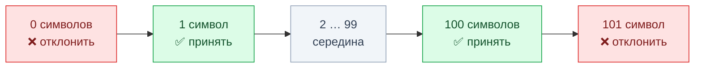
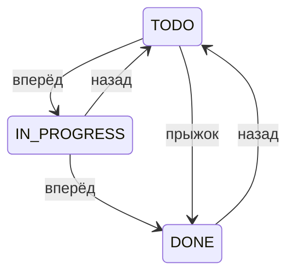

# Техники тест-дизайна

<LessonTabs>
<template #theory>

## Простыми словами

Проверить программу «со всех сторон» невозможно: даже в одно поле можно ввести тысячи разных значений. Техники тест-дизайна помогают выбрать немного проверок, которые находят большую часть ошибок.

Это не магия, а простые правила: какие значения взять и почему именно их.

## Зачем нужны техники

Чутьё у тестировщика тоже работает. Но его трудно объяснить коллеге: почему ты проверил эти пять значений, а не другие? И легко что-то упустить — просто потому, что не пришло в голову.

Техника — это правило, которое можно применить осознанно и объяснить. Сравни:

- «Я проверил 0, 1, 100 и 101 символ, потому что по требованиям название — от 1 до 100 символов».
- «Я проверил пару значений на глаз».

Первое звучит убедительно, второе — нет.

У каждой техники есть **источник** — документ, из которого берутся данные: какие значения допустимы, где граница, какие действуют правила. Обычно это спецификация, техническое задание (ТЗ) или пользовательская история. В TaskFlow источник — описание API, файл `docs/API_SPEC.md`.

::: tip Главное правило
Нет источника — нет техники. Если граница или правило нигде не записаны, ты их не применяешь, а придумываешь. Правильный шаг в такой ситуации — спросить того, кто ставил задачу.
:::

На собеседовании часто спрашивают не «какие техники ты знаешь», а «откуда ты возьмёшь для них данные». Ответ — из источника.

## Эквивалентное разбиение

Представь поле «Название задачи». В него можно ввести строку длиной 1 символ, 2, 3… и так далее. Перебирать всё подряд бессмысленно.

Зато можно заметить: на многие значения программа реагирует одинаково. Любое название длиной от 1 до 100 символов она должна принять. Любое длиннее 100 — отклонить.

Такие группы значений называют **классами эквивалентности**. Из каждого класса достаточно проверить одно значение — «представителя». Если он ведёт себя правильно, весь класс, скорее всего, тоже.

Это и есть **эквивалентное разбиение**: делим все значения на классы и проверяем по одному значению из каждого.

**Пример в TaskFlow.** По спецификации название задачи (`title` в запросе `POST /tasks`) — от 1 до 100 символов.

| Класс | Какие значения | Представитель | Ожидаем |
|---|---|---|---|
| Пустое | 0 символов | `""` | задача не создаётся |
| Допустимое | от 1 до 100 символов | `Написать тесты` | задача создаётся |
| Слишком длинное | 101 символ и больше | строка из 150 символов | задача не создаётся |

Три проверки вместо сотни.

**Источник:** описание допустимых значений поля — спецификация, ТЗ, пользовательская история.

## Граничные значения

Ошибки любят прятаться на краях. Разработчик написал в проверке `<` вместо `<=` — и допустимый диапазон сдвинулся на единицу. Значение из середины, например 50 символов, такую ошибку не заметит. Заметит только значение ровно на границе.

Поэтому **анализ граничных значений** проверяет саму границу и по одному шагу за неё с каждой стороны. Это продолжение эквивалентного разбиения: граничные значения подсказывают, какого представителя брать в первую очередь — того, кто стоит на краю класса.

Для названия задачи (от 1 до 100 символов) получается четыре проверки:



- **0** — на шаг меньше минимума, должно быть отклонено;
- **1** — минимум, должно быть принято;
- **100** — максимум, должно быть принято;
- **101** — на шаг больше максимума, должно быть отклонено.

**Ещё пример: пароль при регистрации.** По спецификации пароль — от 8 до 64 символов. Значит, проверяем длины 7, 8, 64 и 65.

Здесь есть ловушка. У пароля есть и другие правила: минимум одна строчная буква, одна заглавная и цифра. Если в тесте на 7 символов нарушить ещё и состав, ты не поймёшь, на что именно ругается система.

Меняй в одном тесте что-то одно, а остальные правила пусть выполняются. Например: `Abcdef1` — 7 символов, `Abcdef12` — 8.

**Источник:** явно записанные пределы — минимум и максимум длины, диапазон чисел, лимит количества. Если предел нигде не указан, границу брать неоткуда.

## Таблица принятия решений

Иногда результат зависит не от одного условия, а от нескольких сразу. Например, может ли человек сменить статус задачи, зависит и от его роли в проекте, и от того, назначен ли он исполнителем. Если описывать такие случаи текстом, какое-нибудь сочетание обязательно потеряется.

**Таблица принятия решений** собирает все условия и их сочетания в одну таблицу. Каждая строка — одно сочетание условий, в последних столбцах — что должно произойти. Если о каком-то сочетании забыли, это сразу видно: для него нет строки.

**Пример в TaskFlow.** Условия: роль в проекте и «назначен ли исполнителем задачи». Действия: изменить название задачи и сменить её статус. Ожидаемые результаты взяты из раздела спецификации о ролях и доступе к задаче.

| Роль в проекте | Исполнитель задачи? | Изменить название | Сменить статус |
|---|---|---|---|
| `OWNER` | неважно | ✅ разрешено | ✅ разрешено |
| `MANAGER` | неважно | ✅ разрешено | ✅ разрешено |
| `VIEWER` | нет | ❌ запрещено (403) | ❌ запрещено (403) |
| `VIEWER` | да | ❌ запрещено (403) | ❓ по спецификации не определено — уточнить |
| не участник проекта | да | ❌ запрещено (403) | ✅ разрешено |
| не участник проекта | нет | ❌ задача не видна (404) | ❌ задача не видна (404) |

Глобального администратора (`ADMIN`) в таблицу не включили: по спецификации у него полный доступ к любым задачам.

Посмотри на строку с ❓. Спецификация описывает отдельно участника с ролью `VIEWER` и отдельно исполнителя, который не состоит в проекте. А если человек и `VIEWER`, и исполнитель одновременно? Об этом не сказано.

Таблица сама показала пробел в требованиях. Это тоже результат тестирования: такой вопрос задают аналитику или разработчику до того, как решать, баг это или нет.

**Источник:** описание бизнес-правил, например ролевая модель. Если такого описания нет, условия и правила собирают в разговоре с аналитиком или командой.

## Переходы состояний

У многих объектов есть состояния. У задачи в TaskFlow их три: `TODO` (сделать), `IN_PROGRESS` (в работе) и `DONE` (готово). Задача переходит из одного состояния в другое.

Проверить, что каждое состояние вообще бывает, мало. Важнее проверить сами **переходы**: какие разрешены, какие запрещены и что случится при «необычном» переходе. Это техника **переходов состояний**.

Переходы бывают трёх видов:



На схеме — варианты переходов, которые стоит проверить, а не правила TaskFlow: какие из них разрешены, спецификация не говорит.

- **Вперёд** — обычный следующий шаг: `TODO → IN_PROGRESS`, `IN_PROGRESS → DONE`.
- **Назад** — возврат: `IN_PROGRESS → TODO`, `DONE → TODO`. Такие переходы часто забывают проверить.
- **Прыжок** — через промежуточное состояние: `TODO → DONE`, минуя `IN_PROGRESS`.

**Что говорит спецификация.** Она перечисляет статусы, но не говорит, какие переходы между ними разрешены. В работе так бывает часто.

Гадать «наверное, назад нельзя» не нужно. Сформулируй гипотезу — например, «думаю, разрешены все переходы» — и проверь её тестами на каждый вид перехода. Потом сверь результат с командой.

На собеседовании это звучит так: «Формального источника нет, поэтому я сформулирую гипотезу о правилах переходов и проверю её тестами».

**Источник:** диаграмма состояний или описание жизненного цикла объекта в требованиях.

## На открытом проекте

Тот же приём можно попробовать без TaskFlow — на учебной форме [demoqa.com/automation-practice-form](https://demoqa.com/automation-practice-form). Это открытый сайт для тренировки тестировщиков.

Найди поле **Mobile**. Рядом с ним написано «(10 Digits)»: форма ждёт номер из 10 цифр. Эта подпись и есть наш источник.

Классы эквивалентности:

| Класс | Представитель |
|---|---|
| Меньше 10 цифр | `12345` |
| Ровно 10 цифр | `9876543210` |
| Больше 10 цифр | `123456789012` |
| Не цифры | `abcdefghij` |

Граничные значения — 9, 10 и 11 цифр. Минимум и максимум здесь совпадают, поэтому проверок три, а не четыре.

Попробуй каждое значение. Остальные обязательные поля (имя, фамилия, пол) заполни правильно и нажми **Submit**. Запиши, что произошло.

Подсказка: с 11 цифрами кое-что может случиться ещё до отправки. Внимательно посмотри, что окажется в поле.

## Как выбрать технику

| Что видишь в требованиях | Какую технику брать |
|---|---|
| У поля есть диапазон: длина строки, числа «от и до» | Эквивалентное разбиение и граничные значения — обычно вместе |
| Результат зависит от нескольких условий сразу: роль и действие, роль и участие в проекте | Таблица принятия решений |
| У объекта есть состояния и переходы: статус задачи, статус проекта | Переходы состояний |

Единого порядка «сначала эта техника, потом та» нет. Не спрашивай себя «какую технику я знаю лучше». Спроси: «что в этой функции задаёт границу, сочетание условий или смену состояний?» — и техника выберется сама.

## Частые ошибки новичков

- **Проверять только «счастливый путь».** «Форма отправилась» — это один представитель одного класса. Пустые, слишком длинные и неправильные значения остаются непроверенными.
- **Брать границы «из головы».** Сначала найди предел в спецификации. Нет предела — спроси, а не придумывай.
- **Путать представителя класса с границей.** 50 символов — хороший представитель класса «допустимое название», но не граница. Границы — 1 и 100.
- **Считать, что одной техники хватит.** Эквивалентное разбиение без граничных значений пропускает ошибки на краях.
- **Забывать про переходы назад.** Задачу провели по пути `TODO → IN_PROGRESS → DONE`, а вернуть её из `DONE` обратно никто не попробовал.

</template>
<template #task>

## Что нужно сделать

Применить минимум две техники к настоящему запросу TaskFlow и оформить результат как тест-кейсы. Цель — не найти баги, а научиться выбирать проверки осознанно.

**Ветка TaskFlow:** `training-public`. Перед началом запусти TaskFlow у себя на компьютере. Пошаговая инструкция — в файле `README.md` репозитория TaskFlow (ветка `training-public`).

## Шаг 1. Выбери запрос

Возьми создание задачи — `POST /tasks`. Его описание есть в `docs/API_SPEC.md`.

Можно выбрать и другой запрос TaskFlow, если у него есть текстовое поле с ограничением длины.

## Шаг 2. Классы и границы

1. Выбери в запросе текстовое поле с ограничением длины.
2. Найди это ограничение в `docs/API_SPEC.md`. Не бери число по памяти: название задачи (1–100) из теории — только образец.
3. Выпиши классы эквивалентности: ниже минимума, в пределах диапазона, выше максимума.
4. Выпиши граничные значения: на шаг меньше минимума, минимум, максимум, на шаг больше максимума.
5. Для каждого граничного значения оформи тест-кейс из трёх частей: предусловия, шаги, ожидаемый результат. Одной строки «проверить 101 символ» недостаточно.

Образец одного тест-кейса — это формат, а не готовый ответ:

```text
Кейс: название задачи длиной ровно 1 символ (минимум)
Предусловия: пользователь вошёл в систему, у него роль MANAGER или OWNER
             в проекте; известен projectId этого проекта
Шаги: отправить POST /tasks с телом { projectId, title: "X" }
      и остальными обязательными полями из спецификации
Ожидаемый результат: 201, задача создана, в ответе title = "X"
```

## Шаг 3. Переходы состояний

Примени технику переходов к статусам задачи `TODO` / `IN_PROGRESS` / `DONE`. Нужно минимум три тест-кейса — по одному на каждый вид перехода:

1. **Вперёд** — например, `TODO → IN_PROGRESS`.
2. **Назад** — например, `DONE → TODO`. Объясни в паре предложений, почему этот переход стоит проверить, а не пропустить как «маловероятный».
3. **Прыжок** — `TODO → DONE`, минуя `IN_PROGRESS`. Объясни, чем он отличается от обычного шага вперёд.

Формат тот же: предусловия, шаги, ожидаемый результат.

::: tip Что писать в «ожидаемом результате»
Спецификация не говорит, какие переходы разрешены. Поэтому жёсткое «должно быть 200» здесь не подойдёт. Напиши, что именно ты проверишь и как поймёшь результат.

Например: «Переход либо разрешён (200, статус сменился), либо отклонён (код ошибки 4xx). Записываю, что произошло, и уточняю правило у команды». Ни один из этих вариантов сам по себе не баг.
:::

## Разминка на открытом проекте

TaskFlow пока не запускается? Начни с поля **Mobile** на форме [demoqa.com/automation-practice-form](https://demoqa.com/automation-practice-form). Разбор — во вкладке «Теория», раздел «На открытом проекте».

1. Выпиши классы эквивалентности для поля.
2. Выпиши граничные значения.
3. Оформи тест-кейсы и пройди их на сайте.
4. Запиши, что произошло на самом деле.

Когда стенд TaskFlow заработает, вернись к шагам 1–3: основное задание — по TaskFlow.

## Как сдавать

Оформи результат (таблицы / тест-кейсы) в документе или таблице и отправь
куратору лично — в чат или на созвоне.

Что должно быть в результате:

- какой запрос TaskFlow ты тестировал (например, `POST /tasks`);
- тест-кейсы по классам и границам из шага 2;
- минимум три тест-кейса по переходам состояний из шага 3.

</template>
<template #questions>

## Ситуационные кейсы

Это рабочие ситуации, о которых могут спросить и на собеседовании. Готового ответа, который нужно угадать, здесь нет. Сначала подумай сам, потом открывай разбор.

::: details Кейс 1. «Просто проверь, что форма отправляется»
**Ситуация.** Времени мало, нужно протестировать форму с несколькими полями. Разработчик говорит: «Просто проверь, что форма отправляется». С какой техники начать?

**Как рассуждать.** Мало времени — это не выбор между «всё поверхностно» и «одно поле досконально». Это вопрос, где больше всего риска. «Форма отправляется» — ровно одна проверка: все поля заполнены правильно. Подумай, у каких полей есть чёткая граница (длина, диапазон), а у каких нет.

**Пример ответа.** Проверка «форма отправляется» покрывает только класс правильных значений. Она не проверяет ни пустые обязательные поля, ни значения на границе длины.

При нехватке времени я выберу одно-два поля с самой чёткой и рискованной границей и применю к ним граничные значения. Четыре коротких теста — на шаг меньше минимума, минимум, максимум, на шаг больше максимума — займут немного времени. Зато они хорошо ловят типичную ошибку `<` вместо `<=`. Правильное значение из середины такую ошибку не найдёт никогда.

Разработчику не нужно говорить общее «надо больше тестов». Лучше прямо назвать, что его проверка не покрывает, и предложить несколько конкретных тестов на границах.
:::

::: details Кейс 2. «Только счастливый путь»
**Ситуация.** Перед релизом менеджер проекта (PM) просит проверить «только счастливый путь». Ты считаешь, что этого мало. Как возразить языком техник, а не словами «чувствую, что надо больше»?

**Как рассуждать.** С фразой «чувствую, что надо больше» нельзя ни согласиться, ни поспорить: PM не может оценить риск, который ты не назвал. Подумай, чем фраза «не проверен класс пустых значений для поля X» лучше фразы «надо протестировать тщательнее». И помни: решение о релизе принимает PM. Твоя задача — не продавить своё мнение, а дать точную картину.

**Пример ответа.** Я назову конкретно, что останется непроверенным. Например:

- «Не проверили, что будет при пустом обязательном поле» — класс недопустимых значений.
- «Не проверили значение ровно на границе длины» — граничные значения.
- «Не проверили возврат задачи из `DONE` в `TODO`» — переходы состояний.

К каждому пункту — короткое объяснение, почему это рискованно именно здесь. Тогда у PM будет список рисков, а не ощущение, что «тестировщик опять перестраховывается».

Дальше PM решает сам: принять риск осознанно (например, из-за сроков) или попросить закрыть отдельные пункты до релиза. Это его право, так же как решение о приоритете бага.
:::

::: details Кейс 3. Тесты прошли — значит, поле проверено полностью?
**Ситуация.** Ты применил эквивалентное разбиение и проверил по одному значению из каждого класса. Все тесты прошли. Значит, поле проверено полностью? Что осталось непроверенным?

**Как рассуждать.** Эквивалентное разбиение держится на допущении: все значения внутри класса ведут себя одинаково. Это допущение, а не гарантия. Вспомни, зачем вообще существует вторая техника — граничные значения. И подумай: зависит ли поведение поля только от его значения или ещё от чего-то в запросе?

**Пример ответа.** Нет, не полностью. Эквивалентное разбиение проверяет одно значение из класса, а не его края. Поэтому разбиение и граничные значения работают в паре: даже если представитель «допустимой строки» прошёл, минимум, максимум и шаг за них остались непроверенными. А ошибки чаще всего живут именно там.

Кроме того, «все значения класса ведут себя одинаково» — это предположение. Внутри класса «допустимая строка» могут прятаться особые случаи, которые я не выделил отдельно: строка из одних пробелов, строка с невидимыми символами.

И наконец, разбиение проверяет поле отдельно от всего остального. Если результат зависит ещё от роли пользователя или от других полей, нужна другая техника — таблица принятия решений.

«Тесты прошли» значит «представитель каждого класса ведёт себя как ожидалось». Это не то же самое, что «поле проверено полностью», и путать эти утверждения не стоит ни в отчёте, ни в своих выводах.
:::

## Вопросы для собеседования

<InterviewTrainer topic="osnovy/tehniki-test-dizayna" />

</template>
</LessonTabs>
