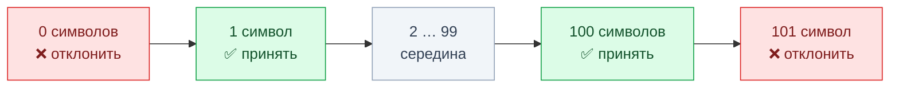
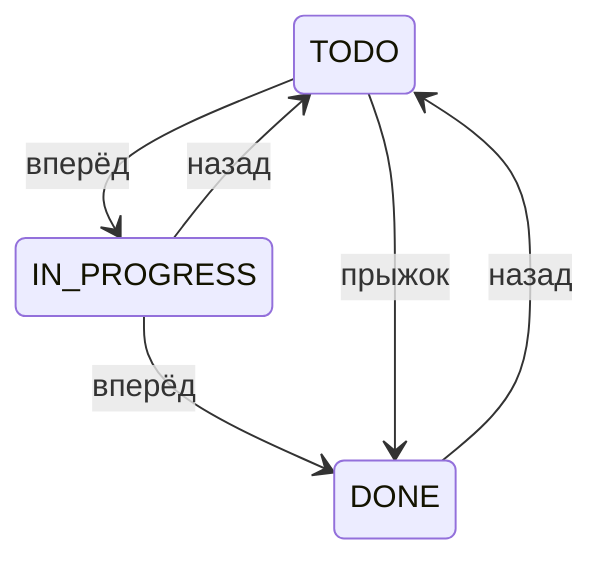
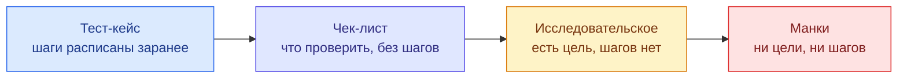

# Техники тест-дизайна

<LessonTabs>
<template #theory>

## Простыми словами

Проверить программу «со всех сторон» невозможно: даже в одно поле можно ввести тысячи разных значений. Техники тест-дизайна помогают выбрать немного проверок, которые находят большую часть ошибок.

Это не магия, а простые правила: какие значения взять и почему именно их.

## Зачем нужны техники

Чутьё у тестировщика тоже работает. Но его трудно объяснить коллеге: почему ты проверил эти пять значений, а не другие? И легко что-то упустить — просто потому, что не пришло в голову.

Техника — это правило, которое можно применить осознанно и объяснить. Сравни:

- «Я проверил 0, 1, 100 и 101 символ, потому что по требованиям название — от 1 до 100 символов».
- «Я проверил пару значений на глаз».

Первое звучит убедительно, второе — нет.

У каждой техники есть **источник** — документ, из которого берутся данные: какие значения допустимы, где граница, какие действуют правила. Обычно это спецификация, техническое задание (ТЗ) или пользовательская история. В TaskFlow источник — описание API, файл `docs/API_SPEC.md`.

::: tip Главное правило
Нет источника — нет техники. Если граница или правило нигде не записаны, ты их не применяешь, а придумываешь. Правильный шаг в такой ситуации — спросить того, кто ставил задачу.
:::

На собеседовании часто спрашивают не «какие техники ты знаешь», а «откуда ты возьмёшь для них данные». Ответ — из источника.

## Эквивалентное разбиение

Представь поле «Название задачи». В него можно ввести строку длиной 1 символ, 2, 3… и так далее. Перебирать всё подряд бессмысленно.

Зато можно заметить: на многие значения программа реагирует одинаково. Любое название длиной от 1 до 100 символов она должна принять. Любое длиннее 100 — отклонить.

Такие группы значений называют **классами эквивалентности**. Из каждого класса достаточно проверить одно значение — «представителя». Если он ведёт себя правильно, весь класс, скорее всего, тоже.

Это и есть **эквивалентное разбиение**: делим все значения на классы и проверяем по одному значению из каждого.

**Пример в TaskFlow.** По спецификации название задачи (`title` в запросе `POST /tasks`) — от 1 до 100 символов.

| Класс | Какие значения | Представитель | Ожидаем |
|---|---|---|---|
| Пустое | 0 символов | `""` | задача не создаётся |
| Допустимое | от 1 до 100 символов | `Написать тесты` | задача создаётся |
| Слишком длинное | 101 символ и больше | строка из 150 символов | задача не создаётся |

Три проверки вместо сотни.

**Источник:** описание допустимых значений поля — спецификация, ТЗ, пользовательская история.

## Граничные значения

Ошибки любят прятаться на краях. Разработчик написал в проверке `<` вместо `<=` — и допустимый диапазон сдвинулся на единицу. Значение из середины, например 50 символов, такую ошибку не заметит. Заметит только значение ровно на границе.

Поэтому **анализ граничных значений** проверяет саму границу и по одному шагу за неё с каждой стороны. Это продолжение эквивалентного разбиения: граничные значения подсказывают, какого представителя брать в первую очередь — того, кто стоит на краю класса.

Для названия задачи (от 1 до 100 символов) получается четыре проверки:



- **0** — на шаг меньше минимума, должно быть отклонено;
- **1** — минимум, должно быть принято;
- **100** — максимум, должно быть принято;
- **101** — на шаг больше максимума, должно быть отклонено.

**Ещё пример: пароль при регистрации.** По спецификации пароль — от 8 до 64 символов. Значит, проверяем длины 7, 8, 64 и 65.

Здесь есть ловушка. У пароля есть и другие правила: минимум одна строчная буква, одна заглавная и цифра. Если в тесте на 7 символов нарушить ещё и состав, ты не поймёшь, на что именно ругается система.

Меняй в одном тесте что-то одно, а остальные правила пусть выполняются. Например: `Abcdef1` — 7 символов, `Abcdef12` — 8.

**Источник:** явно записанные пределы — минимум и максимум длины, диапазон чисел, лимит количества. Если предел нигде не указан, границу брать неоткуда.

## Таблица принятия решений

Иногда результат зависит не от одного условия, а от нескольких сразу. Например, может ли человек сменить статус задачи, зависит и от его роли в проекте, и от того, назначен ли он исполнителем. Если описывать такие случаи текстом, какое-нибудь сочетание обязательно потеряется.

**Таблица принятия решений** собирает все условия и их сочетания в одну таблицу. Каждая строка — одно сочетание условий, в последних столбцах — что должно произойти. Если о каком-то сочетании забыли, это сразу видно: для него нет строки.

**Пример в TaskFlow.** Условия: роль в проекте и «назначен ли исполнителем задачи». Действия: изменить название задачи и сменить её статус. Ожидаемые результаты взяты из раздела спецификации о ролях и доступе к задаче.

| Роль в проекте | Исполнитель задачи? | Изменить название | Сменить статус |
|---|---|---|---|
| `OWNER` | неважно | ✅ разрешено | ✅ разрешено |
| `MANAGER` | неважно | ✅ разрешено | ✅ разрешено |
| `VIEWER` | нет | ❌ запрещено (403) | ❌ запрещено (403) |
| `VIEWER` | да | ❌ запрещено (403) | ❓ по спецификации не определено — уточнить |
| не участник проекта | да | ❌ запрещено (403) | ✅ разрешено |
| не участник проекта | нет | ❌ задача не видна (404) | ❌ задача не видна (404) |

Глобального администратора (`ADMIN`) в таблицу не включили: по спецификации у него полный доступ к любым задачам.

Посмотри на строку с ❓. Спецификация описывает отдельно участника с ролью `VIEWER` и отдельно исполнителя, который не состоит в проекте. А если человек и `VIEWER`, и исполнитель одновременно? Об этом не сказано.

Таблица сама показала пробел в требованиях. Это тоже результат тестирования: такой вопрос задают аналитику или разработчику до того, как решать, баг это или нет.

**Источник:** описание бизнес-правил, например ролевая модель. Если такого описания нет, условия и правила собирают в разговоре с аналитиком или командой.

## Попарное тестирование

В таблице принятия решений мы перебрали все сочетания условий. Это работает, пока условий мало. С каждым новым параметром число сочетаний растёт очень быстро.

Возьмём три параметра по три значения в каждом. Все сочетания — это 3 × 3 × 3 = **27** проверок. Добавь четвёртый такой параметр — уже 81.

Выручает простое наблюдение из практики. Большинство ошибок вызывает одно значение какого-то параметра или **пара** значений двух параметров. Например, «падает, когда статус `DONE`» или «падает, когда статус `DONE` и приоритет `HIGH` одновременно». Ошибки, которым нужно точное сочетание сразу трёх параметров, встречаются гораздо реже.

Отсюда идея **попарного тестирования** (по-английски pairwise): не перебирать все сочетания, а подобрать проверки так, чтобы **каждая пара значений** встретилась хотя бы один раз. В одной проверке участвуют сразу несколько пар, поэтому проверок нужно намного меньше.

**Пример в TaskFlow.** Список задач — запрос `GET /tasks`. По спецификации его можно отфильтровать по статусу (`status`) и по приоритету (`priority`). Смотреть задачи проекта может участник с любой ролью. Получается три параметра:

- статус: `TODO`, `IN_PROGRESS`, `DONE`;
- приоритет: `LOW`, `MEDIUM`, `HIGH`;
- роль того, кто смотрит список: `OWNER`, `MANAGER`, `VIEWER`.

Полный перебор — 27 проверок. Попарный набор — 9:

| № | Фильтр `status` | Фильтр `priority` | Роль в проекте |
|---|---|---|---|
| 1 | `TODO` | `LOW` | `OWNER` |
| 2 | `TODO` | `MEDIUM` | `MANAGER` |
| 3 | `TODO` | `HIGH` | `VIEWER` |
| 4 | `IN_PROGRESS` | `LOW` | `MANAGER` |
| 5 | `IN_PROGRESS` | `MEDIUM` | `VIEWER` |
| 6 | `IN_PROGRESS` | `HIGH` | `OWNER` |
| 7 | `DONE` | `LOW` | `VIEWER` |
| 8 | `DONE` | `MEDIUM` | `OWNER` |
| 9 | `DONE` | `HIGH` | `MANAGER` |

Ожидаемый результат в каждой строке один и тот же: ответ 200, и в списке только задачи с выбранными статусом и приоритетом. Чтобы проверка что-то значила, заранее создай в проекте задачи с разными статусами и приоритетами — иначе фильтру нечего отсеивать.

::: tip Как убедиться, что пара покрыта
Возьми любую пару, например «статус `IN_PROGRESS` + роль `VIEWER`», и найди её в таблице. Это строка 5. Так можно проверить любую из 27 пар: каждая встретится ровно один раз.
:::

Попарное тестирование не заменяет таблицу принятия решений. Если правило явно зависит от сочетания условий (как права на задачу зависят от роли и от того, исполнитель ли ты), проверяй все сочетания. Попарный набор подходит, когда параметры в основном независимы, а сочетаний слишком много для полного перебора.

**Источник:** список параметров и их допустимых значений — спецификация, ТЗ, настройки или фильтры, описанные в требованиях.

### Инструменты

Для трёх параметров таблицу легко составить вручную. Для пяти-шести — уже трудно, и здесь помогают генераторы.

**PICT** — бесплатная утилита от Microsoft, запускается из командной строки. Скачать её можно на GitHub: [github.com/microsoft/pict](https://github.com/microsoft/pict).

Сначала опиши параметры в текстовом файле, например `model.txt`. Одна строка — один параметр и его значения через запятую:

```text
Status:   TODO, IN_PROGRESS, DONE
Priority: LOW, MEDIUM, HIGH
Role:     OWNER, MANAGER, VIEWER
```

Потом запусти PICT и передай ему этот файл:

```text
pict model.txt
```

Он выведет таблицу, в которой покрыта каждая пара. Строки могут идти в другом порядке, чем в нашем примере, а иногда их получается на одну-две больше. Это нормально: важно, чтобы встретились все пары.

Если не хочется ставить программу, есть онлайн-генератор [Pairwise Online Tool](https://pairwise.teremokgames.com/). Впиши названия параметров в верхнюю строку, значения — в столбцы под ними и нажми **Generate Pairwise**. Готовая таблица скачается файлом Excel.

## Переходы состояний

У многих объектов есть состояния. У задачи в TaskFlow их три: `TODO` (сделать), `IN_PROGRESS` (в работе) и `DONE` (готово). Задача переходит из одного состояния в другое.

Проверить, что каждое состояние вообще бывает, мало. Важнее проверить сами **переходы**: какие разрешены, какие запрещены и что случится при «необычном» переходе. Это техника **переходов состояний**.

Переходы бывают трёх видов:



На схеме — варианты переходов, которые стоит проверить, а не правила TaskFlow: какие из них разрешены, спецификация не говорит.

- **Вперёд** — обычный следующий шаг: `TODO → IN_PROGRESS`, `IN_PROGRESS → DONE`.
- **Назад** — возврат: `IN_PROGRESS → TODO`, `DONE → TODO`. Такие переходы часто забывают проверить.
- **Прыжок** — через промежуточное состояние: `TODO → DONE`, минуя `IN_PROGRESS`.

**Что говорит спецификация.** Она перечисляет статусы, но не говорит, какие переходы между ними разрешены. В работе так бывает часто.

Гадать «наверное, назад нельзя» не нужно. Сформулируй гипотезу — например, «думаю, разрешены все переходы» — и проверь её тестами на каждый вид перехода. Потом сверь результат с командой.

На собеседовании это звучит так: «Формального источника нет, поэтому я сформулирую гипотезу о правилах переходов и проверю её тестами».

**Источник:** диаграмма состояний или описание жизненного цикла объекта в требованиях.

## На открытом проекте

Тот же приём можно попробовать без TaskFlow — на учебной форме [demoqa.com/automation-practice-form](https://demoqa.com/automation-practice-form). Это открытый сайт для тренировки тестировщиков.

Найди поле **Mobile**. Рядом с ним написано «(10 Digits)»: форма ждёт номер из 10 цифр. Эта подпись и есть наш источник.

Классы эквивалентности:

| Класс | Представитель |
|---|---|
| Меньше 10 цифр | `12345` |
| Ровно 10 цифр | `9876543210` |
| Больше 10 цифр | `123456789012` |
| Не цифры | `abcdefghij` |

Граничные значения — 9, 10 и 11 цифр. Минимум и максимум здесь совпадают, поэтому проверок три, а не четыре.

Попробуй каждое значение. Остальные обязательные поля (имя, фамилия, пол) заполни правильно и нажми **Submit**. Запиши, что произошло.

Подсказка: с 11 цифрами кое-что может случиться ещё до отправки. Внимательно посмотри, что окажется в поле.

## Техники на основе опыта

Все техники выше берут проверки из источника: спецификации, ТЗ, правил. Но есть и другая группа. В ней проверки рождаются из опыта тестировщика и из самого продукта: ты смотришь, как программа себя ведёт, и решаешь, куда копнуть дальше.

В начале урока мы говорили, что чутьё трудно объяснить коллеге. Техники на основе опыта как раз превращают чутьё в понятную работу: с целью, списком идей и записями.

Они не заменяют формальные техники, а дополняют их. Особенно когда спецификации мало или нет совсем.

Помни главное правило из начала урока. Идеи для проверок здесь даёт опыт, но ожидаемый результат ты всё равно не придумываешь. Если в источнике не сказано, как должно быть, — записываешь, что увидел, и спрашиваешь.

### Предугадывание ошибок

У опытного тестировщика со временем появляется список мест, где программы ломаются снова и снова. **Предугадывание ошибок** — это проверки по такому списку.

Типичные места:

- пустой ввод или ввод из одних пробелов;
- очень длинные строки;
- спецсимволы и эмодзи: `<`, `>`, `'`, `"`, `&`, 😀;
- пробелы в начале и в конце значения;
- двойной клик по кнопке «Сохранить»;
- кнопка «Назад» в браузере сразу после отправки формы;
- один и тот же объект редактируют в двух вкладках одновременно.

**Пример в TaskFlow.** Название задачи (`title`) — от 1 до 100 символов. Что можно попробовать:

- название из одних пробелов, например `"   "`. Формально в нём 3 символа — но считать ли это названием?
- название с пробелами по краям: `"  Купить молоко  "`. Сохранятся ли пробелы в ответе?
- название из эмодзи: `"🚀🚀🚀"`. Как система посчитает его длину?
- один и тот же запрос `POST /tasks` отправить два раза подряд — так в API выглядит двойной клик. Сколько задач появится?

Как TaskFlow должен вести себя в этих случаях, спецификация не говорит. Значит, то, что ты увидишь, — повод для вопроса команде, а не готовый баг.

### Исследовательское тестирование

В **исследовательском тестировании** ты одновременно изучаешь продукт, придумываешь проверки и сразу их выполняешь. Заранее написанных шагов нет: следующая проверка зависит от того, что ты увидел в предыдущей.

Звучит как «потыкать наугад», но это не так. У хорошей исследовательской сессии есть три вещи:

- **Миссия** (по-английски charter) — одна фраза: что исследуем и с какой целью.
- **Ограничение по времени** — например, 30 или 60 минут. Время вышло — сессия закончена.
- **Записи** — что проверил, что нашёл, какие появились вопросы. Без записей результат сессии остаётся только у тебя в голове.

ISTQB (международная организация, которая описывает стандарты тестирования) относит исследовательское тестирование к техникам на основе опыта.

**Пример миссии для TaskFlow:**

> Исследовать комментарии к задаче: что происходит при редактировании и удалении в разных ролях — 30 минут.

Шаблон записей может быть совсем простым:

```text
Миссия: ...
Время: 30 минут

Что проверил:
- ...

Что нашёл:
- ...

Вопросы:
- ...
```

В «Что нашёл» попадают и баги, и просто странности. В «Вопросы» — всё, что непонятно по спецификации. Это такой же ценный результат, как ❓ в таблице принятия решений.

### Эвристики: откуда брать идеи для сессии

Миссия есть, таймер запущен — а что проверять? Чтобы не застрять на первых трёх очевидных идеях, опытные тестировщики пользуются **эвристиками** — короткими подсказками-напоминаниями. Эвристика не говорит, что правильно. Она подсказывает, куда ещё посмотреть.

Самая известная — **SFDIPOT** (её предложил Джеймс Бах). Каждая буква — сторона продукта:

| Буква | Что это | Вопрос к продукту |
|---|---|---|
| **S** — Structure | Из чего состоит | Какие экраны, модули, файлы, внешние сервисы участвуют? |
| **F** — Function | Что умеет | Какие действия доступны, включая редкие? |
| **D** — Data | С какими данными работает | Пустые, огромные, кириллица, эмодзи, чужой формат? |
| **I** — Interfaces | Как общается с миром | Импорт, экспорт, API, уведомления, интеграции |
| **P** — Platform | На чём работает | Браузеры, ОС, версии телефонов, медленная сеть |
| **O** — Operations | Как им пользуются на самом деле | Кто, как часто, в спешке, с ошибками |
| **T** — Time | Что зависит от времени | Часовые пояса, полночь, сроки, долгие паузы, одновременные действия |

Вторая популярная идея — **туры** по продукту (их описал Джеймс Уиттакер). Тур — это сессия с одной темой, как экскурсия по городу. Например, **денежный тур** — пройти всё, за что пользователь платит; **тур по задворкам** — заглянуть в редкие экраны и настройки, куда никто не ходит; **ночной тур** — оставить продукт открытым надолго и посмотреть, что случится с сессией и данными.

Эвристики хорошо работают, когда спецификации мало: за 10 минут по SFDIPOT набирается список идей на несколько сессий.

### Манки-тестирование

**Манки-тестирование** (от английского monkey — обезьяна) — это случайные, хаотичные действия без цели: нажимать на всё подряд, вводить что попало, быстро переключаться между экранами. Как будто за клавиатуру посадили обезьяну.

Честно говоря, строго это не техника тест-дизайна, а скорее подход к тестированию: никаких проверок здесь не проектируют. Но на собеседованиях о нём часто спрашивают рядом с техниками, поэтому разберём.

Главное отличие от исследовательского тестирования:

- **исследовательское** — исследование с целью: есть миссия, и каждое следующее действие выбрано осознанно;
- **манки** — хаос без цели: действия случайные.

Манки-тестирование полезно, чтобы проверить устойчивость: не падает ли программа, не зависает ли от неожиданной последовательности действий. Его слабое место — воспроизведение. Если программа упала после сотни случайных кликов, повторить точный путь трудно. Поэтому записывай, что делаешь, — или хотя бы включи запись экрана.

Часто манки-тестирование автоматизируют: например, для веб-страниц есть библиотека gremlins.js, которая сама «обстреливает» страницу случайными кликами и вводом.

### От сценария к хаосу

Подходы к тестированию можно расставить на одной шкале: от проверок строго по заранее написанному сценарию до действий совсем без сценария.



Ни один край шкалы не «лучше». Тест-кейс легко повторить, но он видит только то, что в нём записано. Исследовательская сессия находит неожиданное, но зависит от опыта и записей. В реальной работе их сочетают.

## Как выбрать технику

| Что видишь в требованиях и в продукте | Какую технику брать |
|---|---|
| У поля есть диапазон: длина строки, числа «от и до» | Эквивалентное разбиение и граничные значения — обычно вместе |
| Результат зависит от нескольких условий сразу: роль и действие, роль и участие в проекте | Таблица принятия решений |
| У объекта есть состояния и переходы: статус задачи, статус проекта | Переходы состояний |
| Много независимых параметров, и все сочетания перебрать нереально: фильтры, настройки | Попарное тестирование |
| Поле или форма, где обычно ломается: пробелы, длинные строки, эмодзи, повторная отправка | Предугадывание ошибок |
| Спецификации мало или нет, функция новая, нужно быстро понять, как она работает | Исследовательское тестирование |
| Нужно проверить устойчивость: не падает ли программа от случайных действий | Манки-тестирование |

Единого порядка «сначала эта техника, потом та» нет. Не спрашивай себя «какую технику я знаю лучше». Спроси: «что в этой функции задаёт границу, сочетание условий или смену состояний?» — и техника выберется сама.

Техники на основе опыта добавляй поверх формальных: они находят то, чего нет в спецификации.

## Разборы из жизни

В учебных примерах у поля одна граница, а у объекта три статуса. В реальных продуктах границы зависят от даты и часового пояса, параметров десятки, а статусы меняют сразу несколько людей. Ниже — пять таких ситуаций. Сначала подумай сам, какие техники применишь, потом открывай.

::: details Разбор 1. «Дата рождения, только 18+» — регистрация в брокерском приложении
**Ситуация.** Мобильное приложение брокера. Открывать счёт можно только с 18 лет. В задаче написано: «Поле "Дата рождения", пользователь должен быть совершеннолетним». Разработчик спрашивает: «Проверишь 17 и 25 лет — и хватит?»

**Что видит мидл.**

- 17 и 25 — представители двух классов, но не границы. Граница здесь — **день**, а не год: человеку исполняется 18 сегодня, вчера или завтра.
- Граница двигается каждый день. Тест «дата 14.10.2008 — принять» сегодня верный, а через год проверяет уже что-то другое. Значит, в кейсе нужно записывать не дату, а правило: «ровно 18 лет сегодня».
- **Чей «сегодня»?** Сервер может жить по Москве, а пользователь — во Владивостоке, где уже наступило завтра. У человека день рождения, он открывает счёт в 01:00 по местному времени — а сервер считает, что ему ещё 17.
- **29 февраля.** Человек родился 29.02.2008. Когда ему исполнится 18 в невисокосном 2026 году — 28 февраля или 1 марта? Это вопрос не к тестировщику, а к юристам, но поднять его должен тестировщик.
- Другие классы, которые легко забыть: дата в будущем, сегодняшняя дата, 01.01.1900, возраст 130 лет, дата в формате другой локали (`10/14/2008` против `14.10.2008`), ручной ввод вместо календаря.

**Что делать.**

1. Выписать граничные значения относительно «сегодня»: исполнилось 18 вчера, сегодня, исполнится завтра.
2. Спросить PO и бэкенд:
   > По какому времени считаем возраст — по часовому поясу сервера или пользователя? И что с рождёнными 29 февраля: совершеннолетие 28 февраля или 1 марта? Нужен ответ юристов.
3. Для кейсов с «сегодня» договориться о тестовой подмене даты на стенде (или о проверке через ручной ввод даты на день вперёд/назад) — иначе граница будет «гулять».
4. Проверить, что ограничение есть и на сервере, а не только в календаре приложения: в календаре можно запретить выбор, но запрос можно отправить в обход.

**Чего не делать.**

- Не писать в кейсе фиксированную дату «14.10.2008 — принять» без пометки, что она посчитана от даты прогона.
- Не решать самому, когда совершеннолетие у рождённых 29 февраля.
:::

::: details Разбор 2. Суточный лимит переводов — интернет-банк
**Ситуация.** Банк вводит лимит: «Не больше 100 000 ₽ переводов в сутки». Задача кажется простой: проверить 100 000 и 100 001.

**Что видит мидл.**

- Лимит **накопительный**: граница проходит не по одной операции, а по сумме за период. 60 000 + 40 000 — ровно лимит, 60 000 + 40 000,01 — уже сверху.
- Шаг у денег — **копейка**, а не рубль. Значит, граничные значения: 99 999,99, 100 000,00 и 100 000,01.
- «Сутки» — это какие? Календарные (с 00:00 до 23:59) или скользящие 24 часа от первого перевода? И опять: по какому часовому поясу?
- Какие операции считаются? Переводы между своими счетами, оплата ЖКХ, переводы по номеру телефона — все в общий лимит или нет?
- Что с отменёнными и возвращёнными переводами: освобождают лимит или нет?
- Два перевода по 60 000, отправленные почти одновременно с двух устройств. Если сервер проверяет лимит, а записывает сумму чуть позже, оба могут пройти — итого 120 000.

**Что делать.**

1. Собрать вопросы одним сообщением аналитику: тип суток, часовой пояс, какие операции входят в лимит, что с отменами.
2. Построить проверки как таблицу «уже потрачено + новая сумма → ожидаемо»:
   ```text
   0          + 100 000,00 → проходит
   0          + 100 000,01 → отказ
   99 999,99  + 0,01       → проходит
   100 000,00 + 0,01       → отказ
   ```
3. Добавить проверки по времени: перевод в 23:59 и в 00:01 (если сутки календарные), или через 23:59 и 24:01 после первого перевода (если скользящие).
4. Попросить разработчика помочь с проверкой одновременных переводов — вручную такую гонку поймать трудно, нужен скрипт.
5. Проверить текст ошибки: пользователь должен понять, сколько ещё можно перевести сегодня и когда лимит обновится.

**Чего не делать.**

- Не ограничиваться одной операцией на 100 001 ₽: это проверка, что работает самое очевидное.
:::

::: details Разбор 3. Фильтры каталога — маркетплейс одежды
**Ситуация.** В каталоге маркетплейса 7 фильтров: категория (12 значений), размер (10), цвет (15), бренд (200), цена «от — до», «есть в наличии» (да/нет), «со скидкой» (да/нет). Плюс сортировка (4 варианта). Менеджер просит «проверить все комбинации фильтров».

**Что видит мидл.**

- Полный перебор — сотни тысяч сочетаний даже без цены. Это не «долго», это невозможно.
- 200 брендов как 200 значений брать не нужно. Для фильтра важны **классы**: бренд, у которого много товаров; бренд с одним товаром; бренд, у которого все товары закончились; бренд с длинным названием или кириллицей.
- Цена «от — до» — это граничные значения: от = до, от > до, пустые поля, копейки, цена ровно на границе.
- Часть ошибок прячется не в сочетаниях, а в **поведении фильтров**: сбрасываются ли они при переходе на вторую страницу, сохраняются ли в ссылке, правильно ли считается число «Найдено: 134» рядом с фильтром.
- Есть сочетания, которые важнее остальных по бизнесу: «размер + в наличии» используют чаще всего. Их стоит проверить глубже, а не просто «одну пару».

**Что делать.**

1. Свести каждый параметр к 3–5 классам. Например, цвет: один цвет, несколько цветов, цвет без товаров.
2. Построить попарный набор генератором — получится 30–40 строк вместо сотен тысяч.
3. Отдельно добавить несколько проверок на самые частые сценарии из аналитики: «женская обувь, размер 38, в наличии, по возрастанию цены».
4. Отдельно — чек-лист на поведение фильтров: пагинация, ссылка с фильтрами, кнопка «Назад», «Сбросить всё», пустой результат.
5. Ответить менеджеру с цифрами:
   > Все комбинации — это больше 100 тысяч проверок. Предлагаю 35 попарных проверок, 5 по самым частым сценариям и чек-лист на поведение фильтров. Это покроет все пары значений и главные пути покупателя.

**Чего не делать.**

- Не обещать «проверю все комбинации» и не проверять в итоге случайные 20.
- Не скармливать генератору 200 брендов: он выдаст тысячи строк, и смысл техники пропадёт.
:::

::: details Разбор 4. Отмена после доставки и возврат после отмены — сервис доставки еды
**Ситуация.** Статусы заказа: «Создан» → «Оплачен» → «Готовится» → «В пути» → «Доставлен». Из любого статуса до «В пути» клиент может отменить заказ. После доставки можно оформить возврат. Аналитик нарисовал диаграмму, на ней только разрешённые стрелки. Тестировщик до тебя проверил все стрелки — все работают.

**Что видит мидл.**

- Проверены только **разрешённые** переходы. А запрещённые — нет: можно ли отменить заказ «В пути»? Оформить возврат по отменённому заказу и получить деньги второй раз? Снова оплатить отменённый заказ?
- Статусы меняет не только клиент: ресторан, курьер, платёжный сервис, автоматическая отмена по таймеру. Что если курьер нажал «Доставлен», а клиент в ту же секунду — «Отменить»?
- Повторное событие: платёжный сервис дважды прислал «оплачено». Не перескочит ли заказ дальше, не спишутся ли деньги дважды?
- Диаграмма показывает стрелки, но не показывает пустоты. Пустоты видно в **таблице переходов**: строки — текущий статус, столбцы — событие, в каждой клетке — что должно произойти.

**Что делать.**

1. Построить таблицу «статус × событие». Шесть статусов × шесть событий — 36 клеток. Разрешённых из них меньше десяти, остальные — проверки, что переход **отклоняется**.
2. Каждую пустую клетку, по которой непонятно, что должно произойти, отдать аналитику:
   > В диаграмме нет перехода «В пути → Отменён». Это значит «запрещено» или «не подумали»? Если запрещено — что видит клиент, когда нажимает «Отменить»?
3. Отдельно проверить переходы, которые делают разные участники одновременно, и повторные события от платёжного сервиса.
4. Самые рискованные запрещённые переходы — те, что связаны с деньгами: двойной возврат, возврат после отмены, оплата отменённого. Их — в регресс.

**Чего не делать.**

- Не считать задачу выполненной, когда «все стрелки на диаграмме работают».
:::

::: details Разбор 5. Скидки, которые складываются — сеть фитнес-клубов
**Ситуация.** Сеть фитнес-клубов запускает онлайн-покупку абонементов. Скидки: студентам 20%, пенсионерам 25%, по промокоду 10%, при покупке на год 15%. В требованиях каждая скидка описана отдельно. Ты строишь таблицу принятия решений и понимаешь, что не знаешь, что делать при нескольких скидках сразу.

**Что видит мидл.**

- Четыре условия «да/нет» — это 16 сочетаний. Таблица сразу показала, что 11 из них в требованиях не описаны.
- Варианты правила: скидки складываются (20 + 15 = 35%), применяются по очереди (сначала 20%, потом 15% от остатка — получится 32%), или действует только самая большая. Разница — деньги клуба.
- Некоторые сочетания невозможны или подозрительны: студент и пенсионер одновременно. Нужно правило, а не догадка.
- Округление: 20% от 4 990 ₽ — 998 ₽, а 15% от 3 992 ₽ — 598,80 ₽. Округляем до рубля? В какую сторону?

**Что делать.**

1. Показать таблицу аналитику и PO целиком — с отмеченными пустыми строками. Таблица убеждает лучше, чем список вопросов: видно, сколько сочетаний не описано.
2. Задать вопрос так, чтобы на него можно было ответить одним решением:
   > Как считаем, если подходят несколько скидок: складываем, применяем по очереди или берём максимальную? И есть ли потолок скидки?
3. Когда правило появится, свернуть таблицу: если «берём максимальную», многие строки дают одинаковый результат и объединяются.
4. На каждое итоговое правило добавить проверку с расчётом до копейки и ожидаемой суммой в кейсе.

**Чего не делать.**

- Не выбирать «самое логичное» правило самому и не писать по нему кейсы до ответа PO.
:::

## Частые ошибки новичков

- **Проверять только «счастливый путь».** «Форма отправилась» — это один представитель одного класса. Пустые, слишком длинные и неправильные значения остаются непроверенными.
- **Брать границы «из головы».** Сначала найди предел в спецификации. Нет предела — спроси, а не придумывай.
- **Путать представителя класса с границей.** 50 символов — хороший представитель класса «допустимое название», но не граница. Границы — 1 и 100.
- **Считать, что одной техники хватит.** Эквивалентное разбиение без граничных значений пропускает ошибки на краях.
- **Забывать про переходы назад.** Задачу провели по пути `TODO → IN_PROGRESS → DONE`, а вернуть её из `DONE` обратно никто не попробовал.
- **Считать исследовательское тестирование «тыканием наугад».** Без миссии, ограничения по времени и записей получается не исследование, а манки-тестирование. И рассказать потом, что проверено, будет нечего.

</template>
<template #task>

## Что нужно сделать

Применить минимум две техники к настоящему запросу TaskFlow и оформить результат как тест-кейсы. Цель — не найти баги, а научиться выбирать проверки осознанно.

Что такое тест-кейс и из каких частей он состоит, разобрано в предыдущем уроке [«Тестовая документация»](/osnovy/07-testovaya-dokumentaciya). Здесь ты применяешь этот формат к значениям, которые подобрала техника.

**Ветка TaskFlow:** `training-public`. Перед началом запусти TaskFlow у себя на компьютере. Пошаговая инструкция — в файле `README.md` репозитория TaskFlow (ветка `training-public`).

## Шаг 1. Выбери запрос

Возьми создание задачи — `POST /tasks`. Его описание есть в `docs/API_SPEC.md`.

Можно выбрать и другой запрос TaskFlow, если у него есть текстовое поле с ограничением длины.

## Шаг 2. Классы и границы

1. Выбери в запросе текстовое поле с ограничением длины.
2. Найди это ограничение в `docs/API_SPEC.md`. Не бери число по памяти: название задачи (1–100) из теории — только образец.
3. Выпиши классы эквивалентности: ниже минимума, в пределах диапазона, выше максимума.
4. Выпиши граничные значения: на шаг меньше минимума, минимум, максимум, на шаг больше максимума.
5. Для каждого граничного значения оформи тест-кейс из трёх частей: предусловия, шаги, ожидаемый результат. Одной строки «проверить 101 символ» недостаточно.

Образец одного тест-кейса — это формат, а не готовый ответ:

```text
Кейс: название задачи длиной ровно 1 символ (минимум)
Предусловия: пользователь вошёл в систему, у него роль MANAGER или OWNER
             в проекте; известен projectId этого проекта
Шаги: отправить POST /tasks с телом { projectId, title: "X" }
      и остальными обязательными полями из спецификации
Ожидаемый результат: 201, задача создана, в ответе title = "X"
```

## Шаг 3. Переходы состояний

Примени технику переходов к статусам задачи `TODO` / `IN_PROGRESS` / `DONE`. Нужно минимум три тест-кейса — по одному на каждый вид перехода:

1. **Вперёд** — например, `TODO → IN_PROGRESS`.
2. **Назад** — например, `DONE → TODO`. Объясни в паре предложений, почему этот переход стоит проверить, а не пропустить как «маловероятный».
3. **Прыжок** — `TODO → DONE`, минуя `IN_PROGRESS`. Объясни, чем он отличается от обычного шага вперёд.

Формат тот же: предусловия, шаги, ожидаемый результат.

::: tip Что писать в «ожидаемом результате»
Спецификация не говорит, какие переходы разрешены. Поэтому жёсткое «должно быть 200» здесь не подойдёт. Напиши, что именно ты проверишь и как поймёшь результат.

Например: «Переход либо разрешён (200, статус сменился), либо отклонён (код ошибки 4xx). Записываю, что произошло, и уточняю правило у команды». Ни один из этих вариантов сам по себе не баг.
:::

## Разминка на открытом проекте

TaskFlow пока не запускается? Начни с поля **Mobile** на форме [demoqa.com/automation-practice-form](https://demoqa.com/automation-practice-form). Разбор — во вкладке «Теория», раздел «На открытом проекте».

1. Выпиши классы эквивалентности для поля.
2. Выпиши граничные значения.
3. Оформи тест-кейсы и пройди их на сайте.
4. Запиши, что произошло на самом деле.

Когда стенд TaskFlow заработает, вернись к шагам 1–3: основное задание — по TaskFlow.

## Мини-задание: попарная таблица

Возьми пример из теории: `GET /tasks` с фильтрами по статусу и приоритету и три роли в проекте.

1. Выпиши три параметра и их значения. Сверь значения статуса и приоритета с `docs/API_SPEC.md`.
2. Составь попарную таблицу: вручную или с помощью PICT. Не копируй таблицу из теории — построй свою.
3. Проверь две-три пары: найди каждую в своей таблице.
4. Посчитай, сколько строк получилось и сколько было бы при полном переборе. Напиши одной фразой, сколько проверок ты сэкономил.
5. Выбери две строки таблицы и пройди их на TaskFlow. Перед этим создай в проекте задачи с разными статусами и приоритетами.

## Мини-задание: исследовательская сессия

Проведи одну исследовательскую сессию на 20 минут. Объект — TaskFlow или поле **Mobile** на demoqa.com, если стенд пока не запускается.

1. Сформулируй миссию одной фразой: что исследуешь и с какой целью. Например: «Исследовать метки задачи: создание, привязка и удаление — 20 минут». Придумай свою.
2. Поставь таймер на 20 минут.
3. По ходу сессии веди записи по шаблону из теории: что проверил, что нашёл, какие вопросы появились.
4. Когда время выйдет, остановись. Даже если хочется проверить «ещё одну вещь» — запиши её в вопросы на следующую сессию.

## Как сдавать

Оформи результат (таблицы / тест-кейсы) в документе или таблице и отправь
куратору лично — в чат или на созвоне.

Что должно быть в результате:

- какой запрос TaskFlow ты тестировал (например, `POST /tasks`);
- тест-кейсы по классам и границам из шага 2;
- минимум три тест-кейса по переходам состояний из шага 3;
- попарная таблица и фраза о том, сколько проверок она сэкономила;
- миссия и записи исследовательской сессии.

</template>
<template #questions>

## Ситуационные кейсы

Это рабочие ситуации, о которых могут спросить и на собеседовании. Готового ответа, который нужно угадать, здесь нет. Сначала подумай сам, потом открывай разбор.

::: details Кейс 1. «Просто проверь, что форма отправляется»
**Ситуация.** Времени мало, нужно протестировать форму с несколькими полями. Разработчик говорит: «Просто проверь, что форма отправляется». С какой техники начать?

**Как рассуждать.** Мало времени — это не выбор между «всё поверхностно» и «одно поле досконально». Это вопрос, где больше всего риска. «Форма отправляется» — ровно одна проверка: все поля заполнены правильно. Подумай, у каких полей есть чёткая граница (длина, диапазон), а у каких нет.

**Пример ответа.** Проверка «форма отправляется» покрывает только класс правильных значений. Она не проверяет ни пустые обязательные поля, ни значения на границе длины.

При нехватке времени я выберу одно-два поля с самой чёткой и рискованной границей и применю к ним граничные значения. Четыре коротких теста — на шаг меньше минимума, минимум, максимум, на шаг больше максимума — займут немного времени. Зато они хорошо ловят типичную ошибку `<` вместо `<=`. Правильное значение из середины такую ошибку не найдёт никогда.

Разработчику не нужно говорить общее «надо больше тестов». Лучше прямо назвать, что его проверка не покрывает, и предложить несколько конкретных тестов на границах.
:::

::: details Кейс 2. «Только счастливый путь»
**Ситуация.** Перед релизом менеджер проекта (PM) просит проверить «только счастливый путь». Ты считаешь, что этого мало. Как возразить языком техник, а не словами «чувствую, что надо больше»?

**Как рассуждать.** С фразой «чувствую, что надо больше» нельзя ни согласиться, ни поспорить: PM не может оценить риск, который ты не назвал. Подумай, чем фраза «не проверен класс пустых значений для поля X» лучше фразы «надо протестировать тщательнее». И помни: решение о релизе принимает PM. Твоя задача — не продавить своё мнение, а дать точную картину.

**Пример ответа.** Я назову конкретно, что останется непроверенным. Например:

- «Не проверили, что будет при пустом обязательном поле» — класс недопустимых значений.
- «Не проверили значение ровно на границе длины» — граничные значения.
- «Не проверили возврат задачи из `DONE` в `TODO`» — переходы состояний.

К каждому пункту — короткое объяснение, почему это рискованно именно здесь. Тогда у PM будет список рисков, а не ощущение, что «тестировщик опять перестраховывается».

Дальше PM решает сам: принять риск осознанно (например, из-за сроков) или попросить закрыть отдельные пункты до релиза. Это его право, так же как решение о приоритете бага.
:::

::: details Кейс 3. Тесты прошли — значит, поле проверено полностью?
**Ситуация.** Ты применил эквивалентное разбиение и проверил по одному значению из каждого класса. Все тесты прошли. Значит, поле проверено полностью? Что осталось непроверенным?

**Как рассуждать.** Эквивалентное разбиение держится на допущении: все значения внутри класса ведут себя одинаково. Это допущение, а не гарантия. Вспомни, зачем вообще существует вторая техника — граничные значения. И подумай: зависит ли поведение поля только от его значения или ещё от чего-то в запросе?

**Пример ответа.** Нет, не полностью. Эквивалентное разбиение проверяет одно значение из класса, а не его края. Поэтому разбиение и граничные значения работают в паре: даже если представитель «допустимой строки» прошёл, минимум, максимум и шаг за них остались непроверенными. А ошибки чаще всего живут именно там.

Кроме того, «все значения класса ведут себя одинаково» — это предположение. Внутри класса «допустимая строка» могут прятаться особые случаи, которые я не выделил отдельно: строка из одних пробелов, строка с невидимыми символами.

И наконец, разбиение проверяет поле отдельно от всего остального. Если результат зависит ещё от роли пользователя или от других полей, нужна другая техника — таблица принятия решений.

«Тесты прошли» значит «представитель каждого класса ведёт себя как ожидалось». Это не то же самое, что «поле проверено полностью», и путать эти утверждения не стоит ни в отчёте, ни в своих выводах.
:::

::: details Кейс 4. Генератор выдал невозможные сочетания
**Ситуация.** Ты строишь попарный набор для оформления заказа в интернет-магазине: способ доставки (курьер, самовывоз, постамат), способ оплаты (карта онлайн, наличные курьеру, при получении в пункте), тип покупателя (новый, постоянный). Генератор выдал таблицу, и в ней есть строки «постамат + наличные курьеру» и «самовывоз + наличные курьеру». Такие заказы оформить нельзя. Что делаешь?

**Как рассуждать.** Если просто удалить невозможные строки, вместе с ними пропадут и пары, которые в них покрывались, — например, «постамат + новый покупатель». Подумай, как сообщить генератору правила продукта и что делать с самими невозможными сочетаниями: они бесполезны или это отдельный вид проверок?

**Пример ответа.** Строки руками удалять не буду: так пропадут пары, которые в них были, и набор перестанет быть попарным.

Вместо этого опишу ограничения прямо в модели генератора. В PICT это делается условиями вида `IF [Доставка] = "Постамат" THEN [Оплата] <> "Наличные курьеру";`. Генератор сам построит набор только из возможных строк, и все допустимые пары в нём останутся.

А невозможные сочетания не выброшу совсем. Это отдельные негативные проверки: интерфейс не должен дать выбрать наличные при доставке в постамат, а если отправить такой заказ в обход интерфейса — сервер должен его отклонить. Таких проверок немного, и они ловят настоящие ошибки.
:::

::: details Кейс 5. «Почему у тебя 14 тестов на одно поле?»
**Ситуация.** Ты показываешь тимлиду набор проверок для поля «Сумма перевода» в мобильном банке: 14 проверок. Тимлид недоволен: «Это одно поле. Зачем 14 тестов? Сделай три». Как ответишь?

**Как рассуждать.** Тимлид не против тестов, он против лишней работы. Ему нужно увидеть, что каждая проверка взялась не «на всякий случай», а из конкретного правила. Подумай, как сгруппировать 14 проверок, чтобы за каждой группой было видно, откуда она и какой риск закрывает. И будь готов честно убрать то, что действительно дублирует.

**Пример ответа.** Я покажу, откуда взялась каждая проверка, сгруппировав их по техникам:

- 4 проверки — границы минимальной суммы и суточного лимита, с шагом в копейку;
- 3 — классы недопустимого ввода: пусто, ноль, отрицательная сумма;
- 3 — формат: запятая и точка, больше двух знаков после запятой, пробелы между разрядами;
- 2 — сумма больше остатка на счёте и ровно весь остаток;
- 2 — двойное нажатие «Перевести» и повтор после обрыва сети.

Это деньги, и почти каждая группа — реальный риск: от лишнего списания до перевода, который ушёл дважды. Если нужно сократить, предложу убрать проверки с самым низким риском, например часть форматов, и прямо запишу, что они не проверены. «Три теста» без объяснения, какие именно, — это не экономия, а неизвестный риск.
:::

## Вопросы для собеседования

<InterviewTrainer topic="osnovy/tehniki-test-dizayna" />

</template>
</LessonTabs>
